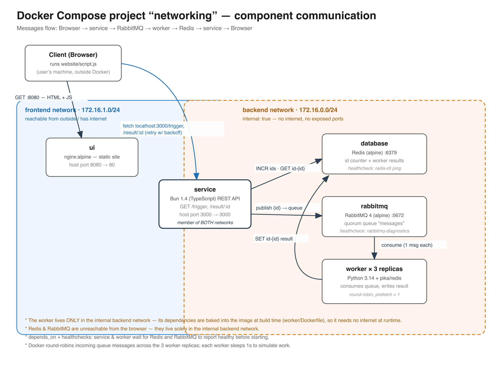

# Distributed service in Docker

- separating frontend and backend networks: the [Redis](https://redis.io/) database and the [RabbitMQ](https://www.rabbitmq.com/) message broker are isolated and not accessible from the outside, they also don't have access to the internet.
- separate networks also control which components can communicate with each other: e.g., the UI should not contact the Redis database directly thus they are placed in separate networks. That way we minimize the attack surface of the system.
- 6 components:
  1. UI - [Nginx](https://nginx.org/)-Webserver that hosts a static page with a simple JavaScript script, it communicates with the backend *service*.
  2. backend service - [Bun](https://bun.com/) JavaScript REST service - when triggered it sends a message to a queue for the asynchronous *worker* (`service/Dockerfile`).
  3. worker - Python based async worker that pulls messages from the queue, processes them and writes the result back to Redis, Docker spawns multiple worker instances that receive and process messages in a Round Robin manner. Its dependencies are baked into a dedicated image (`worker/Dockerfile`), so the worker needs no internet access at runtime.
  4. Redis database - serves as a distributed counter and to persist the result of the workers, that way we can have long running worker jobs (e.g., to run ML tasks) without impacting the UI.
  5. RabbitMQ message broker - for async communication between different system components.
  6. metrics publisher - Python based poller that checks the number of messages in the RabbitMQ queue and publishes to a Redis Timeseries (`metrics/Dockerfile`).
- dependencies between components to ensure they start up in the right order: the worker depends on the Redis database and the RabbitMQ message broker to be up and running, this is done via healthcheck based dependency declarations: https://docs.docker.com/compose/how-tos/startup-order/.
- each component is configured to automatically restart in case of a failure.
- the worker is only attached to the *backend* network: since its Python dependencies are installed at image build time (see `worker/Dockerfile`), it needs no internet access at runtime and stays hidden from users, just like Redis and RabbitMQ.

## How to run
`docker compose up -d --build`